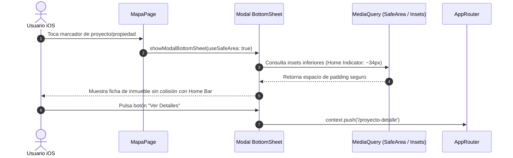

# Plan de Implementación: Aseguramiento de Calidad y Estabilidad para iOS (Flutter)

## 1. Decisiones Técnicas (DT)

* **DT-1 (Permisos de Privacidad y Metadatos en Info.plist):**
  - Declarar `NSPhotoLibraryUsageDescription` y `NSCameraUsageDescription` con mensajes en español claros para el usuario, requeridos por Apple al invocar `FilePicker` (`FileType.image`, `FileType.custom`).
  - Agregar `GADApplicationIdentifier` (identificador oficial de Google AdMob para iOS) y bloques `SKAdNetworkItems` para prevenir la excepción fatal nativa de lanzamiento del SDK de Google Mobile Ads en iOS.
  - Ampliar `LSApplicationQueriesSchemes` con esquemas `tel`, `mailto` y `sms` para soportar la marcación directa y envíos externos desde `ExternalContactLauncher` y `url_launcher`.

* **DT-2 (Alineación de Plataforma, SPM vs CocoaPods y Macros):**
  - Fijar `platform :ios, '15.0'` en `ios/Podfile` e `IPHONEOS_DEPLOYMENT_TARGET = 15.0` en `Runner.xcodeproj` para satisfacer el requisito de `mapbox_maps_flutter` (mínimo 14.0) y la compatibilidad con el toolchain de Xcode moderno (rango soportado 15.0 a 27.0).
  - Resolver el conflicto entre `google_mobile_ads` (CocoaPods) y `webview_flutter_wkwebview` (SPM) configurando `enable-swift-package-manager: false` bajo `flutter.config` en `pubspec.yaml`, eliminando referencias efímeras de SPM en `project.pbxproj` y schemes.
  - Soportar la inyección automática de `GoogleService-Info.plist` según el flavor (`dev`/`prod`) en la fase de construcción de Runner.
  - Configurar las directivas de preprocesador en el bloque `post_install` de `Podfile` (`PERMISSION_LOCATION=1`, `PERMISSION_PHOTOS=1`, `PERMISSION_CAMERA=1`) requeridas por el plugin `permission_handler` para evitar dependencias innecesarias de APIs privadas en iOS.

* **DT-3 (Áreas Seguras y Respeto al Home Indicator en Modales):**
  - En `lib/presentation/pages/navegation/mapa_page.dart`:
    - Activar `useSafeArea: true` en `showModalBottomSheet` tanto para `_showProjectDetails` como para `_showPropertyDetails`.
    - Envolver los contenedores modales en `SafeArea(top: false, child: ...)` asegurando que los botones de acción ("Ver Detalles", precio) mantengan padding ergonómico sobre la barra de inicio táctil (Home Indicator de iPhones sin botón físico).

* **DT-4 (Ergonomía de Teclado y Desplazamiento Nativo):**
  - Integrar `keyboardDismissBehavior: ScrollViewKeyboardDismissBehavior.onDrag` en los formularios extensos (`crear_propiedad_page.dart`, `editar_propiedades_page.dart`, `solicitud_de_arriendo_page.dart`, `complete_tenant_profile_page.dart`, `complete_landlord_profile_page.dart`, `login_page.dart`, `register_page.dart`).
  - Envolver la raíz de las páginas de autenticación con `GestureDetector(onTap: () => FocusScope.of(context).unfocus(), behavior: HitTestBehavior.opaque)` para permitir cerrar el teclado al tocar fuera de los campos.

* **DT-5 (Resiliencia Multiplataforma de Servicios):**
  - Verificar que `InAppUpdateService` ignore completamente plataformas distintas a Android (`Platform.isAndroid`).
  - Verificar que `InAppPurchaseService` y `SubscriptionProvider` utilicen `GooglePlayPurchaseParam` únicamente cuando `defaultTargetPlatform == TargetPlatform.android` y `PurchaseParam` genérico en iOS (`StoreKit`).

* **DT-6 (Pruebas Automatizadas de Compatibilidad iOS):**
  - Crear pruebas unitarias y de widgets que simulen `TargetPlatform.iOS` mediante `debugDefaultTargetPlatformOverride = TargetPlatform.iOS` para validar:
    1. Renderizado seguro con insets inferiores de Home Indicator (p. ej. padding de 34pt).
    2. Comportamiento del teclado en pantalla y su ocultamiento al arrastrar.
    3. Validación estática de metadatos de configuración de `Info.plist` y `Podfile`.

---

## 2. Mapeo Arquitectónico

```text
Capas del Proyecto:
├── ios/
│   ├── Runner/Info.plist              -> Declaración de permisos (Fotos, Cámara, GAD, Schemes) [DT-1]
│   └── Podfile                        -> Definición de platform '13.0' y macros de permisos [DT-2]
├── lib/core/
│   ├── ads/ad_manager.dart            -> IDs y validación de AdMob en iOS [DT-1]
│   └── utils/external_contact_launcher.dart -> Lanzadores telefónicos seguros [DT-1]
├── lib/presentation/
│   ├── pages/navegation/mapa_page.dart -> Modales con useSafeArea y padding para Home Indicator [DT-3]
│   ├── pages/propiedades/             -> Formularios con onDrag dismiss [DT-4]
│   ├── pages/tenant/                  -> Formularios de solicitud con onDrag dismiss [DT-4]
│   └── pages/user/                    -> Login / Register con unfocus táctil [DT-4]
└── test/presentation/
    └── ios/                           -> Pruebas de compatibilidad y adaptabilidad iOS [DT-6]
```

---

## 3. Diagrama de Secuencia: Despliegue Seguro de Modal en iOS


