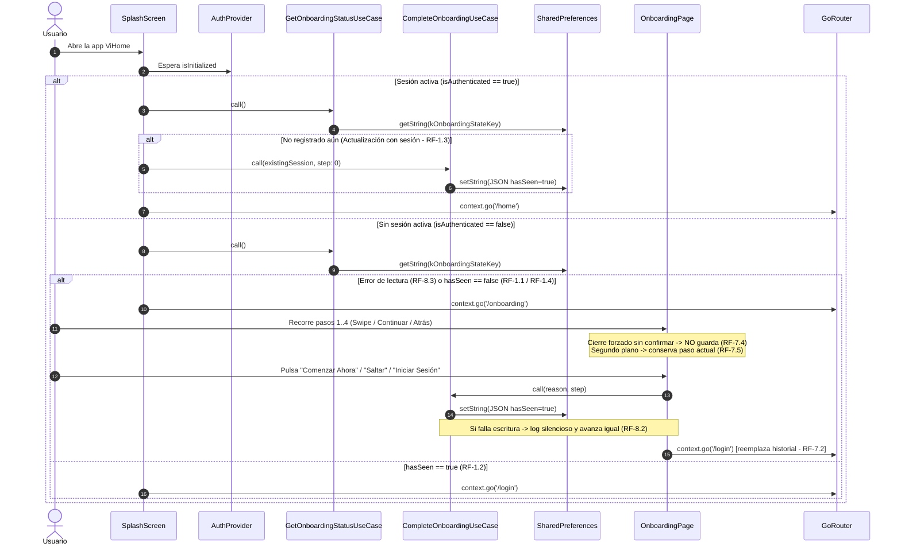

# Plan Técnico de Implementación: Flujo de Onboarding Inicial de ViHome (MVP)

**Especificación de referencia:** `specs/011-vihomeapp-mvp/spec.md`
**Constitución de referencia:** `docs/constitution.md`
**Diseño visual de referencia (Stitch MCP):** Proyecto **ViHome** (`projects/2693693152134648109`), pantallas `0ee4d2defdeb4b149e805a3069754908`, `0799cb96e3994051a7b143beda3cbd53`, `3541069b68834d4690dc5238ad78656c` y `3f594fa0a88649b7b7da3b10e0cd6bd1`.

---

## 1. Estructura de Módulos y Trazabilidad a Requisitos

El diseño sigue estrictamente la arquitectura **Clean Architecture** del proyecto (`Domain` → `Data` → `Presentation` + `Core` + `Assets` + `Test`), usando `get_it`, `provider`, `go_router` y `shared_preferences` ya presentes en `pubspec.yaml` (sin agregar dependencias externas nuevas).

```text
vihomeapp/
├── assets/
│   └── images/
│       └── onboarding/                              # [RF-2, RF-8.1, RNF-1]
│           ├── onboarding_1_space.jpg               # Imagen local empaquetada Paso 1 (sin red)
│           ├── onboarding_2_connection.jpg          # Imagen local empaquetada Paso 2 (sin red)
│           ├── onboarding_3_contracts.jpg           # Imagen local empaquetada Paso 3 (sin red)
│           └── onboarding_4_management.jpg          # Imagen local empaquetada Paso 4 (sin red)
│
├── lib/
│   ├── core/
│   │   ├── constants/
│   │   │   └── storage_keys.dart                    # [RF-7.1, RF-7.3] Constante `kOnboardingStateKey` compartida entre Data y AuthProvider
│   │   ├── di/
│   │   │   └── injection_container.dart             # [RF-1..RF-8] Registro en GetIt de datasource, repo, usecases y OnboardingProvider
│   │   └── router/
│   │       └── app_router.dart                      # [RF-1.1, RF-1.2, RF-4.1, RF-5.1, RF-6.1, RF-7.2] Ruta `/onboarding` y guard redirect
│   │
│   ├── domain/
│   │   ├── entities/
│   │   │   ├── onboarding_state.dart                # [RF-1, RF-7, RF-8] Entidad inmutable de estado visto + razón + timestamp
│   │   │   └── onboarding_step.dart                 # [RF-2] Entidad inmutable de cada paso (índice, título, descripción, asset, CTA, badges)
│   │   ├── repositories/
│   │   │   └── onboarding_repository.dart           # [RF-1, RF-7, RF-8] Contrato `hasSeenOnboarding()`, `getOnboardingState()`, `markOnboardingSeen(reason)`
│   │   └── usecases/
│   │       └── onboarding/
│   │           ├── get_onboarding_status_usecase.dart  # [RF-1.1..RF-1.4, RF-8.3] Consulta con respaldo determinista seguro
│   │           └── complete_onboarding_usecase.dart    # [RF-1.3, RF-4.1, RF-5.1, RF-6.1, RF-7.1, RF-8.2] Persistencia segura no bloqueante
│   │
│   ├── data/
│   │   ├── models/
│   │   │   └── onboarding_state_model.dart          # [RF-7.1, RF-8.2, RF-8.3] Serialización/deserialización JSON tolerante a corrupción
│   │   ├── datasources/
│   │   │   └── onboarding_local_datasource.dart     # [RF-7.1..RF-7.4, RF-8.2, RF-8.3] Lectura/escritura sobre `SharedPreferences`
│   │   └── repositories/
│   │       └── onboarding_repository_impl.dart      # [RF-7, RF-8.2, RF-8.3] Implementación que captura excepciones sin propagar crashes
│   │
│   ├── presentation/
│   │   ├── providers/
│   │   │   ├── auth_provider.dart                   # [RF-7.3] MODIFICACIÓN CRÍTICA: preservar `kOnboardingStateKey` al limpiar caché en `signOut()` y `deleteAccount()`
│   │   │   └── onboarding_provider.dart             # [RF-2, RF-3, RF-4, RF-5, RF-6, RF-7.5, RF-8.2] Control de índice actual, lock anti doble-toque y salida única
│   │   ├── pages/
│   │   │   ├── navegation/
│   │   │   │   └── splash_screen.dart               # [RF-1.1..RF-1.4, RF-8.3] Decisión de enrutamiento inicial tras auth + onboarding
│   │   │   ├── onboarding/
│   │   │   │   ├── onboarding_page.dart             # [RF-2..RF-8, RNF-1..RNF-5] Pantalla principal con `PopScope`, `PageView`, bloqueo vertical, tema claro fijo
│   │   │   │   └── widgets/
│   │   │   │       ├── onboarding_header.dart       # [RF-2.1..RF-2.3, RF-3.2, RF-5.1, RNF-5] Botón atrás (oculto paso 1) y botón "Saltar" (48x48dp + Semantics)
│   │   │   │       ├── onboarding_slide_card.dart   # [RF-2.1, RF-2.6, RF-8.1, RNF-1, RNF-3] Composición visual Azure Horizon con `IgnorePointer` no interactivo
│   │   │   │       ├── onboarding_indicator.dart    # [RF-2.6, RF-3.5, RF-3.6, RNF-2, RNF-5] Indicador animado de 4 pasos (no interactivo + Semantics "Paso X de 4")
│   │   │   │       └── onboarding_footer.dart       # [RF-2.4, RF-2.5, RF-4.1, RF-6.1, RNF-5] CTA ("Continuar" / "Comenzar Ahora") y enlace "Iniciar Sesión"
│   │   │   └── pages.dart                           # Exportación de `OnboardingPage`
│   │   └── app/
│   │       └── app.dart                             # Registro de `OnboardingProvider` en `MultiProvider` si se expone globalmente o inyección local en ruta
│   │
│   └── pubspec.yaml                                 # [RF-8.1, RNF-1] Declaración del directorio `assets/images/onboarding/`
│
└── test/                                            # [Constitución 2.3, DoD]
    ├── data/
    │   ├── models/onboarding_state_model_test.dart
    │   ├── datasources/onboarding_local_datasource_test.dart
    │   └── repositories/onboarding_repository_impl_test.dart
    ├── domain/
    │   └── usecases/onboarding/
    │       ├── get_onboarding_status_usecase_test.dart
    │       └── complete_onboarding_usecase_test.dart
    └── presentation/
        ├── providers/
        │   ├── onboarding_provider_test.dart
        │   └── auth_provider_onboarding_preservation_test.dart
        └── pages/
            ├── splash_screen_onboarding_test.dart
            └── onboarding_page_test.dart
```

---

## 2. Modelo de Datos JSON y Ejemplos

### 2.1. Estado Persistido de Onboarding (`OnboardingStateModel`)
Se almacena como una cadena JSON serializada en `SharedPreferences` bajo la clave constante `vihome_onboarding_state_v1`. Usar un objeto JSON estructurado en lugar de un booleano suelto permite versionado futuro, depuración trazable de la razón de cierre (`completed`, `skipped`, `login_shortcut`, `existing_session`) y deserialización defensiva frente a datos corruptos (`RF-7.1`, `RF-8.2`, `RF-8.3`).

**Esquema de campos:**
| Campo | Tipo JSON | Obligatorio | Descripción | RF Cubierto |
| :--- | :--- | :---: | :--- | :--- |
| `schemaVersion` | `integer` | Sí | Versión del esquema del objeto (`1`). | `RF-7.1` |
| `hasSeenOnboarding` | `boolean` | Sí | Bandera principal que indica si el onboarding ya fue visto. | `RF-1.1`, `RF-1.2`, `RF-7.1` |
| `completionReason` | `string` | Sí | Enumeración: `"completed"`, `"skipped"`, `"login_shortcut"`, `"existing_session"`. | `RF-1.3`, `RF-4.1`, `RF-5.1`, `RF-6.1` |
| `lastCompletedStep` | `integer` | Sí | Último paso visualizado (1..4) o `0` si se omitió automáticamente por sesión activa al actualizar. | `RF-1.3`, `RF-4.1`, `RF-5.1` |
| `completedAtUtc` | `string` (ISO-8601) | Sí | Fecha/hora UTC en que se marcó como visto. | `RF-7.1` |

**Ejemplo JSON persistido (tras completar el paso 4):**
```json
{
  "schemaVersion": 1,
  "hasSeenOnboarding": true,
  "completionReason": "completed",
  "lastCompletedStep": 4,
  "completedAtUtc": "2026-11-18T14:45:00.000Z"
}
```

**Ejemplo JSON persistido (tras actualizar app con sesión activa — `RF-1.3`):**
```json
{
  "schemaVersion": 1,
  "hasSeenOnboarding": true,
  "completionReason": "existing_session",
  "lastCompletedStep": 0,
  "completedAtUtc": "2026-11-18T14:45:00.000Z"
}
```

### 2.2. Modelo de Configuración Inmutable de Pasos (`OnboardingStep`)
Define los 4 pasos fijos en memoria local (sin dependencia remota — `RF-2`, `RF-8.1`, `RNF-1`, Fuera de Alcance #7). Su representación JSON de referencia para pruebas y fixtures (`test/fixtures/onboarding_steps.json`) es:

```json
{
  "totalSteps": 4,
  "steps": [
    {
      "stepNumber": 1,
      "title": "Conecta con tu Espacio Ideal",
      "description": "Encuentra propiedades exclusivas, contacta directamente con arrendadores certificados y gestiona contratos seguros.",
      "imageAsset": "assets/images/onboarding/onboarding_1_space.jpg",
      "ctaLabel": "Continuar",
      "showBackButton": false,
      "showSkipButton": true,
      "cardVisual": {
        "topBadges": ["Verificado", "Pisos de Lujo"],
        "headline": "Penthouse Azure Marina",
        "subtitle": "Zona Financiera",
        "highlightMetric": "$2,400/mes",
        "orbitBadges": ["chat", "verified_user", "landlord_online", "favorite"]
      }
    },
    {
      "stepNumber": 2,
      "title": "Conexión Directa y Transparente",
      "description": "Comunícate en tiempo real con arrendadores y constructoras certificadas, sin intermediarios ni demoras innecesarias.",
      "imageAsset": "assets/images/onboarding/onboarding_2_connection.jpg",
      "ctaLabel": "Continuar",
      "showBackButton": true,
      "showSkipButton": true,
      "cardVisual": {
        "topBadges": ["Verificado"],
        "headline": "Respuesta < 5 min • En línea",
        "subtitle": "Comunicación sin intermediarios",
        "highlightMetric": null,
        "orbitBadges": ["send", "advisor_online", "security"]
      }
    },
    {
      "stepNumber": 3,
      "title": "Contratos Digitales Seguros",
      "description": "Genera y firma contratos de arriendo con total respaldo jurídico y validez legal al instante, desde cualquier lugar.",
      "imageAsset": "assets/images/onboarding/onboarding_3_contracts.jpg",
      "ctaLabel": "Continuar",
      "showBackButton": true,
      "showSkipButton": true,
      "cardVisual": {
        "topBadges": ["Validez Legal 100%"],
        "headline": "Firma Electrónica • Certificación Inmediata",
        "subtitle": "Respaldo jurídico garantizado",
        "highlightMetric": null,
        "orbitBadges": ["lock", "notarial_seal", "shield"]
      }
    },
    {
      "stepNumber": 4,
      "title": "Gestión Integral Sin Fricción",
      "description": "Administra solicitudes, pagos automáticos y el mantenimiento de tu nuevo hogar con una experiencia digital fluida.",
      "imageAsset": "assets/images/onboarding/onboarding_4_management.jpg",
      "ctaLabel": "Comenzar Ahora",
      "showBackButton": true,
      "showSkipButton": true,
      "cardVisual": {
        "topBadges": ["Todo En Uno", "Acceso Conectado"],
        "headline": "Residencia Skyview 402 • Pago al día",
        "subtitle": "Mantenimiento cubierto • 100% Digital",
        "highlightMetric": "Gestión 24/7",
        "orbitBadges": ["key", "auto_debit_active", "check_circle"]
      }
    }
  ]
}
```

---

## 3. Comandos, Salidas y Códigos de Salida

### 3.1. Comandos de Validación, Pruebas y Compilación (CLI del Proyecto)

| Propósito | Comando | Salida esperada (éxito) | Códigos de salida | Cobertura RF / DoD |
| :--- | :--- | :--- | :--- | :--- |
| Instalar y resolver assets/dependencias | `flutter pub get` | `Got dependencies!` (incluye nuevos assets en `assets/images/onboarding/`) | `0`: Éxito<br>`1`: Error en `pubspec.yaml` o resolución de paquetes<br>`65`: Error de formato en manifiesto | `RF-8.1`, `RNF-1` |
| Análisis estático de código y lints | `flutter analyze` | `No issues found!` | `0`: Sin errores ni warnings bloqueantes<br>`1`: Errores de compilación, tipos o reglas de lint | `Constitución 2.3`, `DoD` |
| Pruebas específicas de Onboarding | `flutter test test/domain/usecases/onboarding/ test/data/models/onboarding_state_model_test.dart test/data/datasources/onboarding_local_datasource_test.dart test/data/repositories/onboarding_repository_impl_test.dart test/presentation/providers/onboarding_provider_test.dart test/presentation/providers/auth_provider_onboarding_preservation_test.dart test/presentation/pages/splash_screen_onboarding_test.dart test/presentation/pages/onboarding_page_test.dart` | `All tests passed!` con conteo total de escenarios de RF-1..RF-8 y RNF | `0`: Todas las pruebas pasan<br>`1`: Al menos una aserción falló o hubo excepción no controlada | `RF-1`..`RF-8`, `RNF-1`..`RNF-5`, `DoD` |
| Suite completa de regresión | `flutter test` | `All tests passed!` (346+ pruebas previas + nuevas pruebas de onboarding sin regresiones) | `0`: Suite completa en verde<br>`1`: Regresión detectada en algún módulo | `Constitución 2.3`, `DoD` |
| Verificación de compilación Android (Dev) | `flutter build apk --flavor dev --target lib/env/main.dev.dart --debug` | `✓ Built build/app/outputs/flutter-apk/app-dev-debug.apk` | `0`: Compilación exitosa<br>`1`: Error de compilación Dart/Gradle o asset faltante | `RNF-1`, `DoD` |
| Ejecución interactiva (Dev) | `flutter run --flavor dev --target lib/env/main.dev.dart` | App inicia en `SplashScreen` → `/onboarding` en instalación limpia | `0`: Cierre limpio<br>`1`: Fallo de dispositivo/arranque | `RF-1`..`RF-8` |

### 3.2. Contrato de Salidas Internas de Casos de Uso y Acciones de Navegación

| Operación / Caso de Uso | Entrada | Salida de éxito | Salida ante fallo interno | RF Cubierto |
| :--- | :--- | :--- | :--- | :--- |
| `GetOnboardingStatusUseCase()` | Ninguna (`NoParams`) | `OnboardingState(hasSeenOnboarding: true/false, ...)` | Captura excepción de lectura/JSON corrupto, registra log de depuración y retorna `OnboardingState.notSeen()` (`hasSeenOnboarding: false`) como respaldo determinista sin lanzar excepción | `RF-1.1`, `RF-1.2`, `RF-8.3` |
| `CompleteOnboardingUseCase(reason, step)` | `OnboardingCompletionReason`, `int step` | Persiste JSON en `SharedPreferences` y retorna `true` | Captura excepción de escritura, registra log de depuración y retorna `false` **sin lanzar excepción ni bloquear la navegación a `/login`** | `RF-1.3`, `RF-4.1`, `RF-5.1`, `RF-6.1`, `RF-8.2` |
| `SplashScreen._checkAuthAndNavigate()` | Estado `AuthProvider` + `GetOnboardingStatusUseCase` | • Autenticado → marca visto si `false` (`RF-1.3`) + `context.go('/home')`<br>• No autenticado + `hasSeen == false` → `context.go('/onboarding')`<br>• No autenticado + `hasSeen == true` → `context.go('/login')` | Si falla lectura de onboarding: autenticado → `context.go('/home')`; no autenticado → `context.go('/onboarding')` (`RF-8.3`) | `RF-1.1`..`RF-1.4`, `RF-8.3` |
| `OnboardingProvider.exitOnboarding(reason)` | `reason` (`completed` / `skipped` / `login_shortcut`) | Ejecuta `CompleteOnboardingUseCase`, activa guarda `_isExiting` para ignorar dobles toques y emite señal para ejecutar `context.go('/login')` (reemplazando el historial) | Aunque `CompleteOnboardingUseCase` retorne `false`, ejecuta igualmente `context.go('/login')` sin diálogo ni mensaje técnico | `RF-3.7`, `RF-4.1`, `RF-5.1`, `RF-6.1`, `RF-7.2`, `RF-8.2` |

---

## 4. Decisiones Técnicas Justificadas y Alternativas Descartadas

### DT-1: Almacenamiento local con `SharedPreferences` en formato JSON versionado y preservación explícita en `AuthProvider`
* **Cubre:** `RF-1.1`, `RF-1.2`, `RF-1.3`, `RF-7.1`, `RF-7.3`, `RF-7.4`, `RF-8.2`, `RF-8.3` (y resuelve hallazgo crítico del código existente).
* **Decisión:** Persistir `OnboardingStateModel` en `SharedPreferences` bajo la clave `vihome_onboarding_state_v1` (definida en `lib/core/constants/storage_keys.dart`). Adicionalmente, modificar `AuthProvider.signOut()` y `AuthProvider.deleteAccount()` para leer el valor actual de `kOnboardingStateKey` antes de `prefs.clear()` y restaurarlo inmediatamente después.
* **Hallazgo crítico detectado en codebase:** En el código actual (`lib/presentation/providers/auth_provider.dart` líneas 200 y 237), tanto `signOut()` como `deleteAccount()` invocan `await prefs.clear()`, lo que borraría silenciosamente cualquier bandera guardada en `SharedPreferences` y violaría **`RF-7.3`**.
* **Alternativa descartada:**
  1. *Agregar `flutter_secure_storage` o una base de datos SQLite/Hive separada:* Descartado porque introduce una nueva dependencia nativa innecesaria (y posibles conflictos de CocoaPods/SPM en iOS como los ya ocurridos antes) para una preferencia no sensible de nivel dispositivo. Además, en iOS el Keychain sobrevive a desinstalaciones de la app, lo cual **rompería** el caso límite de reinstalación limpia definido en `spec.md` Sección 6.
  2. *Guardar un booleano simple sin modificar `AuthProvider.signOut()`:* Descartado porque `prefs.clear()` lo eliminaría al cerrar sesión, rompiendo `RF-7.3`.

### DT-2: Decisión de arranque en `SplashScreen` + protección de ruta `/onboarding` en `app_router.dart`
* **Cubre:** `RF-1.1`, `RF-1.2`, `RF-1.3`, `RF-1.4`, `RF-4.1`, `RF-5.1`, `RF-6.1`, `RF-7.2`, `RF-8.3`.
* **Decisión:**
  1. Registrar `/onboarding` en `lib/core/router/app_router.dart` como ruta pública permitida cuando `!isAuthenticated` (junto con `/`, `/login` y `/register`), y redirigir a `/home` si `isAuthenticated` intenta entrar a `/onboarding`.
  2. Centralizar la bifurcación inicial en `SplashScreen._checkAuthAndNavigate()` justo después de confirmar `authProvider.isInitialized`:
     - Si `isAuthenticated == true`: verificar si falta marcar el onboarding como visto; de ser así, invocar `CompleteOnboardingUseCase(reason: existingSession, step: 0)` (`RF-1.3`) sin bloquear y navegar con `context.go('/home')`.
     - Si `isAuthenticated == false`: consultar `GetOnboardingStatusUseCase()`; si `!state.hasSeenOnboarding` navegar con `context.go('/onboarding')` (`RF-1.1`, `RF-1.4`), en caso contrario `context.go('/login')` (`RF-1.2`).
  3. Toda salida del onboarding usa `context.go('/login')` (nunca `context.push`), garantizando que `/onboarding` se remueve completamente del stack de navegación (`RF-7.2`).
* **Alternativa descartada:**
  * *Resolver toda la lógica asíncrona de `SharedPreferences` dentro del callback síncrono `redirect` de `GoRouter`:* Descartado porque `GoRouter.redirect` se reevalúa en cada cambio de ruta y en notificaciones de `AuthProvider`; hacer lecturas/escrituras repetidas allí complica el ciclo de vida durante la animación de 2 segundos de `SplashScreen` y dificulta el respaldo determinista de `RF-8.3`.

### DT-3: Recursos gráficos 100% empaquetados localmente (`assets/images/onboarding/`) + componentes vectoriales nativos Flutter
* **Cubre:** `RF-2.1`, `RF-2.6`, `RF-8.1`, `RNF-1`, `RNF-2`, `RNF-4`.
* **Decisión:** Descargar y optimizar (formato JPG/WebP ligero < 150 KB c/u) las 4 fotografías arquitectónicas/inmobiliarias de las pantallas de Stitch dentro de `assets/images/onboarding/`, declaradas en `pubspec.yaml`, y construir las tarjetas flotantes con rotación suave, chips glassmorphism, insignias en órbita (usando `Material Icons`) y tipografía directamente como widgets Flutter nativos envueltos en `IgnorePointer` para las tarjetas ilustrativas (`RF-2.6`). Pre-cargar las 4 imágenes con `precacheImage` en `didChangeDependencies` de `OnboardingPage` para transiciones < 350 ms (`RNF-2`).
* **Alternativa descartada:**
  * *Usar `CachedNetworkImage` con URLs remotas de Stitch/Supabase:* Descartado porque viola `RF-8.1` y `RNF-1` (requisito estricto de disponibilidad 100% sin conexión desde la instalación).
  * *Exportar cada pantalla completa como una única imagen PNG estática:* Descartado porque rompe la adaptabilidad en pantallas pequeñas/grandes (`RNF-3`), impide exponer textos a lectores de pantalla (`RNF-5`) y pixela las fuentes en distintas densidades de píxeles.

### DT-4: Gestión de navegación interna con `PageView` + `OnboardingProvider` con guarda anti re-entrada y `PopScope`
* **Cubre:** `RF-2.2`..`RF-2.6`, `RF-3.1`..`RF-3.7`, `RF-7.4`, `RF-7.5`, `RNF-2`.
* **Decisión:**
  - `OnboardingPage` (StatefulWidget) mantiene el `PageController` y el estado local del paso actual sincronizado con `OnboardingProvider`, lo cual preserva automáticamente el paso exacto si la app pasa a segundo plano y vuelve (`RF-7.5`), y no persiste nada hasta que se ejecuta una acción explícita de salida (`RF-7.4`).
  - `PageView.builder` con `ClampingScrollPhysics()` impide deslizamientos más allá de los pasos 1 y 4 (`RF-3.3`, `RF-3.4`) y permite avance/retroceso fluido con `animateToPage(..., duration: Duration(milliseconds: 280), curve: Curves.easeOutCubic)` (`RNF-2` < 350 ms).
  - Un flag `_isTransitioning` / `_isExiting` en `OnboardingProvider` + validación de índice evita saltos dobles o navegaciones duplicadas ante pulsaciones rápidas o gestos simultáneos (`RF-3.7`).
  - `PopScope(canPop: currentPage == 0, onPopInvokedWithResult: ...)` intercepta el botón/gesto físico "Atrás" del sistema operativo: en pasos 2–4 (`currentPage > 0`) retrocede exactamente un paso (`RF-3.2`), y en paso 1 (`currentPage == 0`) permite el comportamiento estándar de salida del sistema sin marcar el onboarding como visto (`RF-3.5`).
* **Alternativa descartada:**
  * *4 rutas independientes en `GoRouter` (`/onboarding/1` .. `/onboarding/4`):* Descartado porque pierde el deslizamiento horizontal continuo (`swipe`) con física fluida exigido por `RF-3.1`/`RF-3.2` y genera complejidad innecesaria limpiando 4 entradas del stack al pulsar "Saltar" o "Comenzar Ahora".

### DT-5: Bloqueo de orientación vertical durante el Onboarding + Layout adaptable + Tema Claro de Marca y Accesibilidad
* **Cubre:** `RNF-3`, `RNF-4`, `RNF-5` y Casos Límite (rotación física, modo oscuro del sistema, pantallas compactas, escalado de texto).
* **Decisión:**
  - Aplicar `SystemChrome.setPreferredOrientations([DeviceOrientation.portraitUp])` al entrar en `OnboardingPage` (`initState`) y restaurar orientaciones por defecto al salir (`dispose`), garantizando protección explícita ante rotación física en el MVP.
  - Envolver `OnboardingPage` en `Theme(data: AppTheme.ligthTheme, child: ...)` con `AnnotatedRegion<SystemUiOverlayStyle>` (iconos oscuros en barra de estado sobre fondo claro `#F9F9FE`) para blindar la apariencia clara de marca incluso si el sistema operativo está en modo oscuro (`RNF-4`).
  - Usar `SafeArea` + `LayoutBuilder` + `SingleChildScrollView` (para el cuerpo interno de cada diapositiva manteniendo cabecera y pie accesibles) para evitar `RenderFlex overflow` en pantallas pequeñas o con fuentes grandes (`RNF-3`).
  - Asegurar `constraints: const BoxConstraints(minWidth: 48, minHeight: 48)` en el botón de retroceso, botón *"Saltar"*, botón CTA y enlace *"Iniciar Sesión"*, relación de contraste >= 4.5:1 (`#003760` sobre `#F9F9FE` = 12.1:1; `#FFFFFF` sobre `#003760` = 12.1:1; texto secundario `#424750` sobre `#F9F9FE` = 9.0:1) y etiquetas `Semantics` explícitas (`"Paso ${index + 1} de 4"`, `"Volver al paso anterior"`, `"Saltar introducción"`, `"Iniciar sesión"`) (`RNF-5`).
* **Alternativa descartada:**
  * *Dejar el layout con alturas fijas sin `LayoutBuilder`/`SingleChildScrollView`:* Descartado porque produce `RenderFlex overflow` en pantallas compactas (p. ej. iPhone SE / Android 5.5") o con texto escalado.

---

## 5. Flujo Arquitectónico y Resolución de Hallazgos de QA



### Mapa de Resolución de Hallazgos de QA en este Plan
| Hallazgo QA / Riesgo Técnico | Resolución Técnica en el Plan | RF / RNF |
| :--- | :--- | :--- |
| **`AuthProvider.signOut()` / `deleteAccount()` borra `SharedPreferences` completo** | Preservar `kOnboardingStateKey` antes de `prefs.clear()` y restaurarlo inmediatamente después en `auth_provider.dart` (DT-1). | `RF-7.3` |
| **`app_router.dart` bloquea rutas no autenticadas distintas de `/login` y `/register`** | Incluir `/onboarding` en las rutas permitidas para usuarios no autenticados y redirigir a `/home` si un usuario autenticado intenta acceder (DT-2). | `RF-1.1`, `RF-1.3` |
| **Regresar al onboarding con botón "Atrás" desde `/login`** | Navegar exclusivamente con `context.go('/login')` para reemplazar la pila de navegación (DT-2). | `RF-4.1`, `RF-5.1`, `RF-6.1`, `RF-7.2` |
| **Botón retroceso en paso 1 y gesto/botón "Atrás" del sistema** | `OnboardingHeader` oculta retroceso en índice 0 (usando `Visibility` / `SizedBox(width: 48)` para simetría) y `PopScope(canPop: currentPage == 0)` maneja el botón físico (DT-4). | `RF-2.2`, `RF-2.3`, `RF-3.2`, `RF-3.5` |
| **Botón "Saltar" en el paso 4** | Visible y funcional en los 4 pasos dentro de `OnboardingHeader` con la misma salida hacia `/login` (DT-4). | `RF-2.1`, `RF-5.1` |
| **Doble toque rápido o swipe + toque simultáneo** | Guarda de estado `_isTransitioning` / `_isExiting` en `OnboardingProvider` impide ejecuciones concurrentes y desincronización del indicador (DT-4). | `RF-3.7` |
| **Cierre forzado en pasos 1–4 vs. segundo plano** | Estado en memoria durante el recorrido (solo escribe en `SharedPreferences` al confirmar salida); segundo plano mantiene el `State` vivo en el mismo paso (DT-4). | `RF-7.4`, `RF-7.5` |
| **Modo sin conexión, modo oscuro, rotación y accesibilidad** | Assets locales en `assets/images/onboarding/` (DT-3), tema claro forzado + bloqueo vertical + `LayoutBuilder` + áreas >= 48×48 + contraste >= 4.5:1 + `Semantics` (DT-5). | `RF-8.1`, `RNF-1`..`RNF-5` |
| **Fallos de lectura o escritura en almacenamiento local** | Bloques `try/catch` en repositorio/datasource: lectura fallida → `notSeen()` determinista; escritura fallida → retorna `false` y permite `context.go('/login')` sin bloquear ni mostrar error técnico (DT-1, DT-2). | `RF-8.2`, `RF-8.3` |

---

## 6. Estrategia de Tests (Constitución Sección 2.3)

Todas las pruebas se ejecutan con `flutter test` sin depender de red ni de servicios externos (usando `SharedPreferences.setMockInitialValues`, mocks manuales/fakes compatibles con el proyecto actual sin agregar dependencias nuevas).

### 6.1. Pruebas Unitarias — Capa de Datos y Dominio
1. **`test/data/models/onboarding_state_model_test.dart`**
   - Serialización y deserialización JSON correcta para todos los valores de `completionReason` (`completed`, `skipped`, `login_shortcut`, `existing_session`).
   - Manejo defensivo ante JSON malformado, campos faltantes o tipos inválidos → retorna `notSeen()` sin excepción (`RF-8.3`).
2. **`test/data/datasources/onboarding_local_datasource_test.dart`**
   - Lectura cuando la clave no existe → `hasSeenOnboarding == false` (`RF-1.1`).
   - Escritura y lectura posterior → conserva `hasSeenOnboarding == true`, `completionReason` y `lastCompletedStep` (`RF-7.1`).
   - Simulación de excepción en lectura/escritura de `SharedPreferences` (`RF-8.2`, `RF-8.3`).
3. **`test/data/repositories/onboarding_repository_impl_test.dart`**
   - Garantiza que fallos de lectura retornan respaldo seguro (`hasSeenOnboarding == false`) sin propagar excepciones (`RF-8.3`).
   - Garantiza que fallos de escritura retornan `false` sin lanzar excepciones (`RF-8.2`).
4. **`test/domain/usecases/onboarding/get_onboarding_status_usecase_test.dart`** y **`complete_onboarding_usecase_test.dart`**
   - Verifican la delegación correcta al repositorio para cada razón de cierre y paso (`RF-1`, `RF-4`, `RF-5`, `RF-6`, `RF-7`).

### 6.2. Pruebas Unitarias — Providers y Regresión de Sesión
5. **`test/presentation/providers/onboarding_provider_test.dart`**
   - Inicia en paso 0 (Paso 1 visual), avanza hasta paso 3 (Paso 4 visual) sin exceder límites (`RF-3.1`, `RF-3.3`, `RF-3.4`).
   - Retrocede correctamente desde pasos 2–4 y bloquea retroceso en paso 1 (`RF-3.2`, `RF-3.3`).
   - Guarda anti doble-toque (`_isExiting`): invocar dos veces seguidas `exitOnboarding` ejecuta `CompleteOnboardingUseCase` exactamente una vez (`RF-3.7`).
   - Si `CompleteOnboardingUseCase` falla (`false`), `exitOnboarding` igual autoriza navegación a `/login` (`RF-8.2`).
6. **`test/presentation/providers/auth_provider_onboarding_preservation_test.dart`**
   - Verifica explícitamente que `AuthProvider.signOut()` limpia caché de sesión pero **preserva intacta** `kOnboardingStateKey` (`hasSeenOnboarding == true`) (`RF-7.3`).
   - Verifica el mismo comportamiento en `AuthProvider.deleteAccount()` (`RF-7.3`).

### 6.3. Pruebas de Widget e Integración de Flujos
7. **`test/presentation/pages/splash_screen_onboarding_test.dart`**
   - Instalación limpia (`hasSeen == false`, `isAuthenticated == false`) → navega a `/onboarding` (`RF-1.1`, `RF-1.4`).
   - Ya visto (`hasSeen == true`, `isAuthenticated == false`) → navega a `/login` omitiendo onboarding (`RF-1.2`).
   - Actualización con sesión activa (`hasSeen == false`, `isAuthenticated == true`) → marca onboarding como visto (`existing_session`) y navega a `/home` (`RF-1.3`).
   - Error al leer estado de onboarding sin sesión → respaldo determinista hacia `/onboarding` sin crash (`RF-8.3`).
   - Error al leer estado de onboarding con sesión activa → navega a `/home` sin crash (`RF-8.3`).
8. **`test/presentation/pages/onboarding_page_test.dart`**
   - **Contenido de las 4 pantallas (`RF-2.1`..`RF-2.6`):** Valida títulos exactos, descripciones, visibilidad de *"Saltar"* en los 4 pasos, ocultamiento del botón de retroceso en el paso 1, aparición del botón de retroceso en pasos 2–4, cambio del CTA de *"Continuar"* a *"Comenzar Ahora"* en el paso 4 y no interactividad de las tarjetas e indicador.
   - **Navegación bidireccional (`RF-3.1`..`RF-3.7`):** Avance con *"Continuar"* y con `tester.drag` horizontal; retroceso con botón superior, `tester.drag` inverso y `Navigator.maybePop()` / `PopScope`; límites en paso 1 y paso 4; sincronización del indicador de progreso.
   - **Salidas y persistencia (`RF-4.1`, `RF-5.1`, `RF-6.1`, `RF-7.2`, `RF-7.4`):**
     - Pulsar *"Comenzar Ahora"* en paso 4 → guarda `completed`, navega a `/login` y `canPop()` es `false`.
     - Pulsar *"Saltar"* en paso 2 → guarda `skipped`, navega a `/login` y `canPop()` es `false`.
     - Pulsar *"¿Ya tienes una cuenta? Iniciar Sesión"* en paso 1 → guarda `login_shortcut`, navega a `/login` y `canPop()` es `false`.
     - Desmontar la pantalla en paso 2 o paso 4 sin confirmar salida → `hasSeenOnboarding` permanece `false`.
   - **Resiliencia ante error de guardado (`RF-8.2`):** Repositorio simulando error de escritura → al pulsar *"Saltar"* o *"Comenzar Ahora"* navega igualmente a `/login` sin mostrar error técnico.
   - **Responsividad y Accesibilidad (`RNF-3`, `RNF-4`, `RNF-5`):**
     - Renderizado sin errores de `RenderFlex overflow` en tamaño compacto (`320 × 568`) y grande (`430 × 932`).
     - Verificación de tamaño táctil >= `48 × 48` en botones principales/cabecera y presencia de etiquetas `Semantics` (`"Paso 1 de 4"`, etc.).
     - Verificación de ausencia de dependencias de red (solo `Image.asset` locales, cero `Image.network` / `CachedNetworkImage`) (`RF-8.1`, `RNF-1`).

---

## 7. Matriz de Trazabilidad Final (RF / RNF → Plan → Tests)

| Requisito | Módulo(s) en el Plan | Decisión Técnica | Suite de Pruebas |
| :--- | :--- | :---: | :--- |
| `RF-1.1`..`RF-1.4` | `splash_screen.dart`, `app_router.dart`, `get_onboarding_status_usecase.dart` | DT-1, DT-2 | `splash_screen_onboarding_test.dart`, `get_onboarding_status_usecase_test.dart` |
| `RF-2.1`..`RF-2.6` | `onboarding_step.dart`, `onboarding_page.dart`, `onboarding_header.dart`, `onboarding_slide_card.dart`, `onboarding_footer.dart` | DT-3, DT-4 | `onboarding_page_test.dart` |
| `RF-3.1`..`RF-3.7` | `onboarding_provider.dart`, `onboarding_page.dart`, `onboarding_indicator.dart` | DT-4 | `onboarding_provider_test.dart`, `onboarding_page_test.dart` |
| `RF-4.1`, `RF-5.1`, `RF-6.1` | `onboarding_provider.dart`, `complete_onboarding_usecase.dart`, `app_router.dart` | DT-1, DT-2, DT-4 | `onboarding_page_test.dart`, `complete_onboarding_usecase_test.dart` |
| `RF-7.1`..`RF-7.5` | `onboarding_local_datasource.dart`, `auth_provider.dart`, `app_router.dart`, `onboarding_page.dart` | DT-1, DT-2, DT-4 | `onboarding_local_datasource_test.dart`, `auth_provider_onboarding_preservation_test.dart`, `onboarding_page_test.dart` |
| `RF-8.1`..`RF-8.3` | `assets/images/onboarding/`, `onboarding_repository_impl.dart`, `splash_screen.dart`, `onboarding_provider.dart` | DT-1, DT-2, DT-3 | `onboarding_repository_impl_test.dart`, `splash_screen_onboarding_test.dart`, `onboarding_page_test.dart` |
| `RNF-1`..`RNF-5` | `pubspec.yaml`, `onboarding_page.dart`, `onboarding_slide_card.dart`, `onboarding_header.dart`, `onboarding_footer.dart` | DT-3, DT-4, DT-5 | `onboarding_page_test.dart` |
