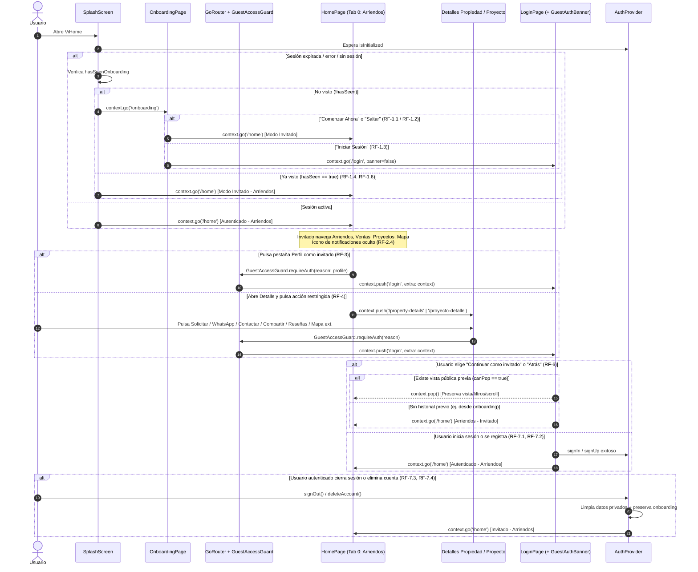

# Plan Técnico de Implementación: Rol Invitado, Exploración Pública y Acceso Inicial a Arriendos (MVP)

**Especificación de referencia:** `specs/012-vihomeapp-mvp/spec.md` (actualizada con resolución integral de hallazgos QA)
**Constitución de referencia:** `docs/constitution.md`
**Especificaciones relacionadas actualizadas por compatibilidad:** `specs/011-vihomeapp-mvp/spec.md` (onboarding y arranque) y `specs/010-account-deletion/spec.md` (destino tras eliminación de cuenta)

---

## 1. Estructura de Módulos y Trazabilidad a Requisitos

El diseño respeta estrictamente la **Clean Architecture** del proyecto (`Domain` → `Data` → `Presentation` + `Core` + `Supabase/SQL` + `Test`), utilizando exclusivamente dependencias ya presentes en `pubspec.yaml` (`go_router`, `provider`, `get_it`, `supabase_flutter`, `shared_preferences`). No se introducen paquetes externos nuevos.

```text
vihomeapp/
├── lib/
│   ├── domain/
│   │   └── entities/
│   │       └── guest_redirect_context.dart            # [RF-3.2, RF-4.2, RF-4.3, RF-5.1, RF-6.2, RF-6.3, RNF-4]
│   │                                                  # Enum `GuestRedirectReason` + entidad inmutable `GuestRedirectContext`
│   │                                                  # (razón, mensaje contextual en español, si muestra banner, ruta origen)
│   │
│   ├── core/
│   │   └── router/
│   │       ├── app_router.dart                        # [RF-1.1..RF-1.7, RF-2.1..RF-2.3, RF-5.1, RF-6.2..RF-6.4, RF-7.1..RF-7.4, RNF-2]
│   │       │                                          # - Ampliación de `isPublicRoute` (`/home`, `/property-details`, `/proyecto-detalle`, `/mapa`)
│   │       │                                          # - Bloqueo de rutas privadas -> `/login` con `GuestRedirectContext.privateRoute`
│   │       │                                          # - Ruta `/property-details` acepta `User?` nullable (elimina error bloqueante `user == null`)
│   │       │                                          # - Ruta `/login` lee `GuestRedirectContext?` desde `state.extra`
│   │       └── guest_access_guard.dart                # [RF-3.1..RF-3.4, RF-4.2..RF-4.4, RF-5.1, RF-6.2, RNF-3]
│   │                                                  # Helper centralizado `GuestAccessGuard.requireAuth(...)` con guarda anti doble-toque
│   │                                                  # (`_isRedirecting`) y `context.push('/login', extra: context)`
│   │
│   ├── presentation/
│   │   ├── providers/
│   │   │   ├── auth_provider.dart                     # [RF-1.5..RF-1.7, RF-2.5, RF-7.1..RF-7.5, RNF-1, RNF-2]
│   │   │   │                                          # - Getter semántico `bool get isGuest => !isAuthenticated;`
│   │   │   │                                          # - Suscripción segura a expiración/revocación de sesión (`onAuthStateChange` / `signedOut`)
│   │   │   │                                          # - Preservación de `kOnboardingStateKey` en `signOut()` y `deleteAccount()`
│   │   │   ├── application_provider.dart              # [RF-7.3, RF-7.4, RNF-2] Método `clear()` / reinicio de contadores y listas privadas al pasar a invitado
│   │   │   ├── tenant_provider.dart                   # [RF-7.3, RF-7.4, RNF-2] Reinicio de perfil privado de arrendatario al pasar a invitado
│   │   │   ├── landlord_provider.dart                 # [RF-7.3, RF-7.4, RNF-2] Reinicio de perfil privado de arrendador al pasar a invitado
│   │   │   └── subscription_provider.dart             # [RF-2.5, RF-7.3, RF-7.4] Reinicio a estado no-premium al pasar a invitado
│   │   │
│   │   ├── widgets/
│   │   │   └── guest_auth_banner.dart                 # [RF-3.2, RF-4.2, RF-4.3, RF-5.1, RNF-4, RNF-5]
│   │   │                                              # Banner informativo contextual accesible (contraste >= 4.5:1, `Semantics`, texto escalable)
│   │   │
│   │   └── pages/
│   │       ├── onboarding/
│   │       │   └── onboarding_page.dart               # [RF-1.1, RF-1.2, RF-1.3]
│   │       │                                          # - `_handleNextOrComplete()` y `_handleSkip()` -> `context.go('/home')` (aun si falla guardado)
│   │       │                                          # - `_handleLoginShortcut()` -> `context.go('/login', extra: GuestRedirectContext.onboardingShortcut())`
│   │       │
│   │       ├── navegation/
│   │       │   ├── splash_screen.dart                 # [RF-1.4, RF-1.5, RF-1.6]
│   │       │   │                                      # - Con `hasSeenOnboarding == true`: siempre `context.go('/home')` (autenticado o invitado)
│   │       │   │                                      # - Ante sesión expirada/revocada o error en verificación: respaldo seguro a modo invitado
│   │       │   ├── home_page.dart                     # [RF-1.4, RF-2.1, RF-3.1..RF-3.4, RF-7.1..RF-7.4, RNF-1, RNF-3]
│   │       │   │                                      # - Índice inicial `0` (`ArriendosPage`)
│   │       │   │                                      # - Intercepta tap en índice `3` (Perfil) si `isGuest` vía `GuestAccessGuard` sin cambiar `_currentIndex`
│   │       │   │                                      # - Cuarta pestaña muestra `Perfil` en modo invitado y al cerrar sesión como arrendador
│   │       │   │                                      # - `PushNotificationService.handleInitialMessage()` solo si `isAuthenticated`
│   │       │   │                                      # - Reseteo de providers privados al pasar de autenticado → invitado (`_onAuthChanged`)
│   │       │   ├── arriendos_page.dart                # [RF-2.2, RF-2.4, RF-8.1, RF-8.3, RNF-1] Oculta ícono de notificaciones cuando `isGuest`
│   │       │   ├── ventas_page.dart                   # [RF-2.2, RF-2.4, RF-8.1, RF-8.3, RNF-1] Oculta ícono de notificaciones cuando `isGuest`
│   │       │   ├── mapa_page.dart                     # [RF-2.2, RF-8.1, RF-8.2, RF-8.4, RNF-1] Permiso de ubicación opcional con fallback sin redirigir a login
│   │       │   ├── perfil_page.dart                   # [RF-7.3, RF-7.4, RF-7.5] `signOut()` y `deleteAccount()` exitosos -> `context.go('/home')` (preservando confirmación de borrado)
│   │       │   └── panel_page.dart                    # [RF-7.3, RF-7.4, RF-7.5] `signOut()` y `deleteAccount()` exitosos -> `context.go('/home')` (preservando confirmación de borrado)
│   │       │
│   │       ├── propiedades/
│   │       │   └── detalles_propiedades_page.dart     # [RF-2.3, RF-2.5, RF-4.1..RF-4.4, RF-8.1, RF-8.4, RNF-1]
│   │       │                                          # - `final User? user;` nullable
│   │       │                                          # - Barra `"Solicitar Arriendo"` visible para invitados en propiedades en arriendo
│   │       │                                          # - Intercepta con `GuestAccessGuard`: Solicitar Arriendo, WhatsApp, Compartir, Reputación detallada y Mapa externo
│   │       │                                          # - Respaldos seguros ante datos incompletos / fallo parcial (sin redirigir a login)
│   │       │
│   │       ├── proyectos/
│   │       │   ├── proyectos_page.dart                # [RF-2.2, RF-2.4, RF-8.1, RF-8.3, RNF-1] Oculta ícono de notificaciones cuando `isGuest`
│   │       │   └── detalles_proyecto_page.dart        # [RF-2.3, RF-4.1, RF-4.3, RF-4.4, RF-8.1, RF-8.4, RNF-1]
│   │       │                                          # - Intercepta con `GuestAccessGuard`: `"Contactar"`, `"Compartir"` y Mapa externo
│   │       │                                          # - Respaldos seguros ante datos incompletos / fallo parcial
│   │       │
│   │       └── user/
│   │           ├── login_page.dart                    # [RF-3.2, RF-4.2, RF-4.3, RF-5.1, RF-6.1..RF-6.5, RF-7.1, RF-7.2, RNF-4, RNF-5]
│   │           │                                      # - Recibe `GuestRedirectContext?` y renderiza `GuestAuthBanner` si `showRestrictionBanner == true`
│   │           │                                      # - Botón explícito `"Continuar como invitado"` (min 48×48 + `Semantics`)
│   │           │                                      # - `PopScope` + AppBar/botón atrás: `pop()` si `canPop()` o `context.go('/home')` si vino sin historial (onboarding)
│   │           │                                      # - Login exitoso (email o Google) -> `context.go('/home')` limpiando la pila
│   │           └── register_page.dart                 # [RF-6.4, RF-7.1, RF-7.2] Regreso limpio a `/login` al cancelar y destino `/home` si registra con sesión inmediata
│   │
├── supabase/                                          # [RF-2.2, RF-2.3, RF-8.3, RNF-2]
│   └── migrations/ (verificación / auditoría RLS)     # Políticas `SELECT` para rol `anon` únicamente en tablas de catálogo público;
│                                                      # bloqueo estricto de `anon` en tablas privadas (`solicitudes`, `profiles`, `arrendatarios`, `suscripciones`)
│
└── test/                                              # [Constitución 2.3, DoD]
    ├── domain/entities/
    │   └── guest_redirect_context_test.dart
    ├── core/router/
    │   ├── guest_access_guard_test.dart
    │   └── app_router_guest_test.dart
    └── presentation/
        ├── providers/
        │   └── auth_provider_guest_session_test.dart
        └── pages/
            ├── onboarding_page_test.dart              # ACTUALIZAR expectativas de salida (`Comenzar Ahora`/`Saltar` -> `/home`)
            ├── splash_screen_onboarding_test.dart     # ACTUALIZAR expectativa (`hasSeen == true && !auth` -> `/home`)
            ├── navegation/
            │   └── home_page_guest_test.dart
            ├── propiedades/
            │   └── detalles_propiedades_guest_test.dart
            ├── proyectos/
            │   └── detalles_proyecto_guest_test.dart
            ├── user/
            │   └── login_page_guest_test.dart
            └── profile/
                ├── delete_account_dialog_test.dart    # ACTUALIZAR/VERIFICAR destino `/home` + preservación de confirmación (`RF-7.4`)
                └── sign_out_guest_flow_test.dart
```

---

## 2. Modelo de Datos JSON y Ejemplos

### 2.1. Contexto de Redirección de Invitado (`GuestRedirectContext`)
Representa de forma estructurada, serializable y testeable el motivo por el cual un usuario no autenticado llega a `/login`. Se pasa mediante `GoRouter` (`state.extra`) y cuenta con serialización JSON (`toJson` / `fromJson`) para trazabilidad, depuración y fixtures de pruebas (`RF-3.2`, `RF-4.2`, `RF-4.3`, `RF-5.1`, `RF-6.2`, `RF-6.3`, `RNF-4`).

**Esquema de campos:**
| Campo | Tipo JSON | Obligatorio | Descripción | RF Cubierto |
| :--- | :--- | :---: | :--- | :--- |
| `reason` | `string` | Sí | Enumeración: `"profile"`, `"rent_application"`, `"whatsapp_contact"`, `"project_contact"`, `"landlord_reviews"`, `"share"`, `"external_map"`, `"private_route"`, `"session_expired"`, `"onboarding_login_shortcut"`. | `RF-1.3`, `RF-1.7`, `RF-3.2`, `RF-4.2`, `RF-4.3`, `RF-5.1` |
| `showRestrictionBanner` | `boolean` | Sí | `true` cuando proviene de una restricción o sesión expirada en vista privada; `false` si proviene del enlace *"Iniciar Sesión"* del onboarding. | `RF-1.3`, `RF-3.2`, `RF-4.2`, `RF-4.3` |
| `bannerMessage` | `string \| null` | No | Texto en español neutro mostrado dentro del `GuestAuthBanner` en `LoginPage`. `null` cuando `showRestrictionBanner == false`. | `RF-3.2`, `RF-4.2`, `RF-4.3`, `RNF-4` |
| `sourcePath` | `string` | Sí | Ruta pública o privada desde la cual se disparó la navegación (ej. `"/home"`, `"/property-details"`, `"/onboarding"`). | `RF-6.2`, `RF-6.3` |
| `canReturnToPreviousView` | `boolean` | Sí | `true` si se abrió mediante `push` desde una vista pública preservada en el historial; `false` si se llegó reemplazando el historial (ej. onboarding o ruta privada). | `RF-6.2`, `RF-6.3` |

**Ejemplo JSON 1 — Redirección desde *"Solicitar Arriendo"* en Detalle de Propiedad (`RF-4.2`):**
```json
{
  "reason": "rent_application",
  "showRestrictionBanner": true,
  "bannerMessage": "Inicia sesión o crea una cuenta para solicitar este arriendo.",
  "sourcePath": "/property-details",
  "canReturnToPreviousView": true
}
```

**Ejemplo JSON 2 — Redirección desde pestaña *"Perfil"* (`RF-3.2`):**
```json
{
  "reason": "profile",
  "showRestrictionBanner": true,
  "bannerMessage": "Inicia sesión o crea una cuenta para acceder a tu perfil.",
  "sourcePath": "/home",
  "canReturnToPreviousView": true
}
```

**Ejemplo JSON 3 — Acceso desde enlace *"Iniciar Sesión"* del Onboarding (`RF-1.3`, `RF-6.3`):**
```json
{
  "reason": "onboarding_login_shortcut",
  "showRestrictionBanner": false,
  "bannerMessage": null,
  "sourcePath": "/onboarding",
  "canReturnToPreviousView": false
}
```

### 2.2. Matriz Declarativa de Política de Acceso y Estado de Sesión (`GuestAccessPolicy` — Fixture JSON)
Sirve como contrato verificable para las pruebas de enrutamiento (`app_router_guest_test.dart`) y auditoría RLS en Supabase (`RF-2.1`..`RF-2.5`, `RF-5.1`, `RNF-2`):

```json
{
  "sessionSnapshot": {
    "isAuthenticated": false,
    "isGuest": true,
    "effectiveRole": "guest",
    "isPremium": false,
    "hasSeenOnboarding": true,
    "showNotificationsIcon": false,
    "fourthTabLabel": "Perfil",
    "defaultHomeTabIndex": 0
  },
  "routePolicy": {
    "publicRoutes": [
      "/",
      "/onboarding",
      "/login",
      "/register",
      "/home",
      "/property-details",
      "/proyecto-detalle",
      "/mapa"
    ],
    "privateRoutes": [
      "/solicitud-arriendo",
      "/solicitudes-arrendatario",
      "/solicitudes-arrendador",
      "/detalle-solicitud",
      "/detalle-solicitud-arrendador",
      "/complete-profile",
      "/complete-landlord-profile",
      "/personal-info",
      "/personal-info-landlord",
      "/mis-propiedades",
      "/crear-propiedad",
      "/editar-propiedad",
      "/location-picker",
      "/notifications_tenant",
      "/notifications_landlord",
      "/subscription"
    ]
  },
  "dataAccessMatrix": {
    "publicReadTables": [
      "propiedades",
      "proyectos",
      "constructoras",
      "arrendadores_public_summary",
      "user_reputation_summary"
    ],
    "privateRestrictedTables": [
      "solicitudes",
      "arrendatarios",
      "profiles",
      "suscripciones",
      "notificaciones"
    ]
  }
}
```

---

## 3. Comandos, Salidas y Códigos de Salida

### 3.1. Comandos CLI de Validación, Pruebas y Compilación

| Propósito | Comando | Salida esperada (éxito) | Códigos de salida | Cobertura RF / DoD |
| :--- | :--- | :--- | :--- | :--- |
| Resolver dependencias del workspace | `flutter pub get` | `Got dependencies!` | `0`: Éxito<br>`1`: Error en `pubspec.yaml` o red<br>`65`: Manifiesto mal formado | `DoD` |
| Análisis estático y reglas de lint | `flutter analyze` | `No issues found!` | `0`: Sin errores ni warnings bloqueantes<br>`1`: Errores de tipos, null-safety o lints | `Constitución 2.3`, `RNF-1`, `DoD` |
| Suite específica de Rol Invitado y Compatibilidad `011`/`010` | `flutter test test/domain/entities/guest_redirect_context_test.dart test/core/router/guest_access_guard_test.dart test/core/router/app_router_guest_test.dart test/presentation/providers/auth_provider_guest_session_test.dart test/presentation/pages/onboarding_page_test.dart test/presentation/pages/splash_screen_onboarding_test.dart test/presentation/pages/navegation/home_page_guest_test.dart test/presentation/pages/propiedades/detalles_propiedades_guest_test.dart test/presentation/pages/proyectos/detalles_proyecto_guest_test.dart test/presentation/pages/user/login_page_guest_test.dart test/presentation/pages/profile/delete_account_dialog_test.dart test/presentation/pages/profile/sign_out_guest_flow_test.dart` | `All tests passed!` con 100% de escenarios `RF-1`..`RF-8` y `RNF-1`..`RNF-5` en verde | `0`: Todas las pruebas pasan<br>`1`: Al menos una aserción falló o excepción no controlada | `RF-1`..`RF-8`, `RNF-1`..`RNF-5`, `DoD` |
| Suite completa de regresión del proyecto | `flutter test` | `All tests passed!` (383+ tests existentes + nuevos tests de rol invitado sin regresiones) | `0`: Suite completa en verde<br>`1`: Regresión detectada en cualquier módulo | `Constitución 2.3`, `DoD` |
| Compilación de verificación Android (Dev) | `flutter build apk --flavor dev --target lib/env/main.dev.dart --debug` | `✓ Built build/app/outputs/flutter-apk/app-dev-debug.apk` | `0`: Compilación exitosa<br>`1`: Error de compilación Dart/Gradle | `DoD` |
| Ejecución manual QA en entorno Dev | `flutter run --flavor dev --target lib/env/main.dev.dart` | Inicio tras onboarding/splash directo en `/home` (`ArriendosPage`) en modo invitado | `0`: Cierre limpio<br>`1`: Error de dispositivo o arranque | `RF-1`..`RF-8` |

### 3.2. Contrato de Salidas Internas de Guardas, Casos de Uso y Flujos de Navegación

| Operación / Componente | Entrada | Salida de éxito | Salida ante fallo / excepción | RF Cubierto |
| :--- | :--- | :--- | :--- | :--- |
| `SplashScreen._checkAuthAndNavigate()` | `AuthProvider` (`isInitialized`, `isAuthenticated`) + `GetOnboardingStatusUseCase` | • Autenticado: marca onboarding visto si faltaba (`RF-1.3` de `011`), inicializa suscripción y ejecuta `context.go('/home')`<br>• No autenticado + `!hasSeen`: `context.go('/onboarding')`<br>• No autenticado + `hasSeen`: `context.go('/home')` (modo invitado en Arriendos) | • Sesión expirada/error al leer usuario: `authProvider.isAuthenticated == false` → sigue el flujo invitado (`context.go('/home')` si `hasSeen`, o `/onboarding` si `!hasSeen`)<br>• Error al leer onboarding sin sesión: respaldo determinista hacia `/onboarding` sin crash | `RF-1.4`, `RF-1.5`, `RF-1.6` |
| `OnboardingPage` (`_handleNextOrComplete` / `_handleSkip` / `_handleLoginShortcut`) | Acción del usuario (`completed`, `skipped`, `loginShortcut`) | • `completed` / `skipped` → guarda `hasSeen = true` y ejecuta `context.go('/home')`<br>• `loginShortcut` → guarda `hasSeen = true` y ejecuta `context.go('/login', extra: GuestRedirectContext.onboardingShortcut())` | Si falla escritura en `SharedPreferences`, `exitOnboarding` continúa igualmente con `context.go('/home')` (o `/login` para `loginShortcut`) sin bloquear ni mostrar error técnico | `RF-1.1`, `RF-1.2`, `RF-1.3` |
| `AppRouter.redirect(context, state)` | `AuthProvider.isAuthenticated` + `state.matchedLocation` | • Ruta en `publicRoutes` → retorna `null` (permite acceso)<br>• Autenticado en `/login`, `/register`, `/onboarding` → retorna `'/home'`<br>• Invitado en ruta privada → retorna `'/login'` (con contexto `private_route`) | Si `AuthProvider` aún no está en el árbol (arranque temprano), captura excepción y retorna `null` delegando a `SplashScreen` | `RF-1.4`, `RF-2.1`..`RF-2.3`, `RF-5.1` |
| `GuestAccessGuard.requireAuth(context, reason, sourcePath)` | `BuildContext`, `GuestRedirectReason`, `sourcePath` | • Si `authProvider.isAuthenticated == true`: retorna `true` (permite ejecutar la acción)<br>• Si `isGuest`: activa lock `_isRedirecting`, ejecuta `context.push('/login', extra: GuestRedirectContext.fromReason(...))`, retorna `false` | Ante doble toque rápido mientras `_isRedirecting == true` o si ya estamos en `/login`, ignora el segundo evento evitando apilar rutas duplicadas | `RF-3.1`..`RF-3.4`, `RF-4.2`..`RF-4.4`, `RNF-3` |
| `LoginPage._handleExitAsGuest()` | Pulsación en *"Continuar como invitado"* o `PopScope` (*"Atrás"*) | • Si `context.canPop()` → `context.pop()` (regresa a Detalle o pestaña pública previa preservando filtros y scroll)<br>• Si `!context.canPop()` (ej. llegó desde onboarding) → `context.go('/home')` | Nunca lanza excepción de stack vacío ni regresa a `/onboarding` | `RF-6.1`..`RF-6.5` |
| `LoginPage._handleLogin()` / `_handleGoogleLogin()` | Credenciales o token de Google | Inicializa `SubscriptionProvider` y ejecuta `context.go('/home')` (limpiando historial previo y aterrizando en Arriendos) | Muestra `UiFeedback.showErrorSnackBar(...)` conservando intacto el botón *"Continuar como invitado"* y el historial para `pop()` | `RF-6.5`, `RF-7.1`, `RF-7.2` |
| `AuthProvider.signOut()` + salida desde `PerfilPage` / `PanelPage` | Solicitud de cierre de sesión | Limpia caché local preservando `kOnboardingStateKey`, resetea providers privados (`Application`, `Tenant`, `Landlord`, `Subscription`), `_user = null` y ejecuta `context.go('/home')` | Si falla la llamada remota a Supabase por falta de red, el bloque `finally` limpia igualmente el estado local, pasa a invitado y navega a `context.go('/home')` | `RF-7.3`, `RNF-2` |
| `AuthProvider.deleteAccount()` + salida desde `PerfilPage` / `PanelPage` | Confirmación de eliminación de cuenta | Borra cuenta en servidor, limpia caché preservando `kOnboardingStateKey`, resetea providers privados, muestra confirmación de cuenta eliminada (`UiFeedback.showSuccessSnackBar`) y ejecuta `context.go('/home')` | Si falla el servidor o red, retorna `false`, mantiene la sesión activa intacta y muestra error con opción de reintento (`010-account-deletion`) | `RF-7.4`, `RF-7.5` |

---

## 4. Decisiones Técnicas Justificadas y Alternativas Descartadas

### DT-1: Rol invitado como estado derivado de sesión no autenticada (`AuthProvider.isGuest => !isAuthenticated`) sin cuentas anónimas remotas
* **Cubre:** `RF-1.4`, `RF-1.5`, `RF-1.6`, `RF-2.1`..`RF-2.5`, `RF-7.1`..`RF-7.4`, `RNF-1`, `RNF-2`.
* **Decisión:** Modelar el rol invitado como el estado natural cuando `AuthProvider.user == null` (`bool get isGuest => !isAuthenticated;`), consumiendo únicamente lecturas públicas de Supabase con la clave `anon`. No se crean usuarios anónimos en `auth.users` ni registros en la tabla `profiles`.
* **Justificación:**
  - Opera 100% instantáneo al arrancar sin latencia de red ni creación de tokens remotos (clave para `RF-1.6`, `RF-8.1` y `RNF-3` < 350 ms).
  - Evita contaminar la tabla `auth.users` y `profiles` con cuentas temporales huérfanas, y mantiene totalmente limpia la lógica de `deleteAccount()` (`010-account-deletion`).
  - Garantiza aislamiento estricto de datos privados (`RNF-2`): `auth.uid()` es `NULL` en Supabase, por lo que cualquier tabla privada con RLS basada en `auth.uid()` bloquea acceso automáticamente.
* **Alternativa descartada:**
  * *Usar `Supabase.instance.client.auth.signInAnonymously()` para cada visitante:* Descartado porque requiere conexión a internet para inicializar el modo invitado (viola `RF-1.1` en modo avión y `RF-8.1`), genera cuentas fantasma en Supabase Auth, complica el flujo de login/registro con Google/Email (requiere conversión/link de identidad) y añade riesgo al borrado de cuentas.

### DT-2: Enrutamiento público en `app_router.dart` + helper centralizado `GuestAccessGuard` con guarda anti doble-toque y navegación `push` vs. `go`
* **Cubre:** `RF-2.1`..`RF-2.3`, `RF-3.1`..`RF-3.4`, `RF-4.2`..`RF-4.4`, `RF-5.1`, `RF-6.2`, `RF-6.3`, `RNF-3`.
* **Decisión:**
  1. Ampliar `isPublicRoute` en `lib/core/router/app_router.dart` para permitir: `'/'`, `'/onboarding'`, `'/login'`, `'/register'`, `'/home'`, `'/property-details'`, `'/proyecto-detalle'` y `'/mapa'`.
  2. Para cualquier ruta **no** incluida en `isPublicRoute`, cuando `!isAuthenticated`, `GoRouter.redirect` retorna `'/login'` (enviando o adjuntando el motivo `private_route` mediante query param `?reason=private_route` o `GuestRedirectContext` por defecto para rutas privadas).
  3. Crear `GuestAccessGuard` (`lib/core/router/guest_access_guard.dart`) que encapsula:
     - Verificación `authProvider.isAuthenticated`.
     - Guarda re-entrante (`bool _isRedirecting = false` con liberación en `finally` tras completar el `await context.push('/login', extra: ...)` o debounce breve) que impide abrir pantallas duplicadas ante doble toque rápido en Perfil o Detalles (`RF-3.4`, `RF-4.4`).
     - Uso de **`context.push('/login', extra: redirectContext)`** cuando el invitado proviene de vistas públicas (`HomePage`, `DetallesPropiedadesPage`, `DetallesProyectoPage`), preservando montada la vista previa en el stack de navegación (lo que preserva automáticamente la pestaña activa, los filtros aplicados y la posición de scroll al regresar — `RF-3.3`, `RF-6.2`).
     - Uso de **`context.go('/home')`** tras autenticación exitosa (`RF-7.2`) y al salir del onboarding (`RF-1.1`), reemplazando el stack completo para impedir regresar al onboarding o a `/login` con *"Atrás"*.
* **Alternativa descartada:**
  * *Usar `context.go('/login')` en todas las redirecciones de invitado:* Descartado porque destruye la pila de navegación (`HomePage` o `DetallesPropiedadesPage`), perdiendo el estado de filtros, el scroll y la capacidad de volver al detalle exacto mediante *"Atrás"* o *"Continuar como invitado"* (`RF-6.2`).
  * *Repetir condicionales `if (!authProvider.isAuthenticated)` manualmente en cada botón:* Descartado porque duplica lógica de mensajes contextuales, facilita inconsistencias y omite la guarda anti doble-toque.

### DT-3: Banner informativo contextual (`GuestAuthBanner`) en `LoginPage` + botón *"Continuar como invitado"* + `PopScope` unificado
* **Cubre:** `RF-1.3`, `RF-3.2`, `RF-4.2`, `RF-4.3`, `RF-5.1`, `RF-6.1`..`RF-6.5`, `RNF-4`, `RNF-5`.
* **Decisión:**
  - `LoginPage` acepta `final GuestRedirectContext? redirectContext;` (resuelto desde `state.extra` o query param `reason` cuando el redirect vino del router).
  - Cuando `redirectContext?.showRestrictionBanner == true`, renderiza `GuestAuthBanner` en la parte superior del formulario con ícono informativo, contraste >= 4.5:1 (`#003760` / superficie suave azulada `#EEF4FA`), `Semantics` descriptivo y mensaje contextual exacto según `GuestRedirectReason`. Si llegó desde el enlace *"Iniciar Sesión"* del onboarding (`showRestrictionBanner == false`), el banner **no** se muestra (`RF-1.3`).
  - Los errores de autenticación (`UiFeedback.showErrorSnackBar`) operan independientemente del banner y nunca alteran el historial de navegación ni ocultan el botón *"Continuar como invitado"* (`RF-6.5`).
  - Debajo del bloque de registro en `LoginPage` (dentro del `SingleChildScrollView` existente para convivir sin solapamientos con el teclado virtual y texto escalado — `RNF-5`), añadir el botón `"Continuar como invitado"` con `minimumSize: const Size(double.infinity, 48)` y `Semantics`.
  - Añadir botón de retroceso en cabecera (o `AppBar` transparente) + `PopScope(canPop: false, onPopInvokedWithResult: ...)` delegando ambos al mismo método `_handleExitAsGuest()`: si `context.canPop()` ejecuta `context.pop()`; en caso contrario ejecuta `context.go('/home')` (`RF-6.2`, `RF-6.3`).
* **Alternativa descartada:**
  * *Mostrar únicamente un `SnackBar` efímero antes o después de ir a `/login`:* Descartado porque desaparece automáticamente tras 3–4 segundos y puede ocultarse con el teclado o ser sobreescrito por un error de login, dejando al usuario sin contexto.
  * *Mostrar un `AlertDialog` de confirmación previo a navegar a `/login`:* Descartado porque añade un paso innecesario de fricción y contraviene la decisión de redirección directa con aviso informativo breve.

### DT-4: Convergencia de Onboarding, Splash, Cierre de Sesión y Eliminación de Cuenta en `/home` (`ArriendosPage`) + limpieza de estado privado
* **Cubre:** `RF-1.1`..`RF-1.6`, `RF-7.1`..`RF-7.5`, Compatibilidad con `011-vihomeapp-mvp` y `010-account-deletion`.
* **Decisión:**
  1. En `OnboardingPage`: `_handleNextOrComplete()` y `_handleSkip()` ejecutan `context.go('/home')`; `_handleLoginShortcut()` ejecuta `context.go('/login', extra: GuestRedirectContext.onboardingShortcut())`.
  2. En `SplashScreen`: cuando `!isAuthenticated` y `hasSeenOnboarding == true`, ejecutar `context.go('/home')`. Si `AuthProvider._initializeAuth()` detecta error de lectura o sesión expirada/revocada, establece `_user = null` y `_isInitialized = true` sin lanzar excepción, permitiendo entrar a `/home` en modo invitado (`RF-1.5`, `RF-1.6`).
  3. En `HomePage`:
     - Mantener `_currentIndex = 0` (`ArriendosPage`).
     - Ejecutar `PushNotificationService.handleInitialMessage()` únicamente si `authProvider.isAuthenticated` (preservando notificaciones para autenticados sin afectar invitados — `RF-1.4`).
     - En `_onAuthChanged()`: cuando `user == null` (transición autenticado → invitado por cierre de sesión, eliminación o expiración), reiniciar `_currentIndex = 0` si estaba en índice `3`, limpiar `ApplicationProvider`, `TenantProvider`, `LandlordProvider` y `SubscriptionProvider` para garantizar cero residuos de datos privados (`RF-7.3`, `RF-7.4`, `RNF-2`).
  4. En `PerfilPage` y `PanelPage`:
     - Tras `authProvider.signOut()`: navegar a `context.go('/home')`.
     - Tras `authProvider.deleteAccount() == true`: navegar a `context.go('/home')` **y** mostrar el `UiFeedback.showSuccessSnackBar` de confirmación de cuenta eliminada (`RF-7.4`, preservando `010-account-deletion`). Si `deleteAccount() == false`, mantener sesión y mostrar error (`RF-7.5`).
* **Alternativa descartada:**
  * *Crear una ruta `/arriendos` separada de `/home`:* Descartado porque `ArriendosPage` ya vive como Tab 0 dentro de `HomePage` con la barra de navegación inferior (`Arriendos`, `Ventas`, `Proyectos`, `Perfil`). Crear otra ruta duplicaría navegación y rompería el cambio fluido entre pestañas.

### DT-5: Adaptación null-safe de vistas públicas (`DetallesPropiedadesPage`, `DetallesProyectoPage`, `ArriendosPage`, `VentasPage`, `ProyectosPage`, `MapaPage`)
* **Cubre:** `RF-2.1`..`RF-2.5`, `RF-4.1`..`RF-4.4`, `RF-8.1`..`RF-8.4`, `RNF-1`.
* **Decisión:**
  1. **`DetallesPropiedadesPage`:**
     - Cambiar parámetro `required this.user` (`User`) a `this.user` (`User?`).
     - Mostrar `_buildTenantActionBar()` cuando `(widget.user == null || widget.user?.role == 'arrendatario') && widget.property.estado == 'arriendo'` (`RF-4.1`).
     - Proteger con `GuestAccessGuard.requireAuth(...)` los 5 puntos interactivos:
       1. Botón `"Solicitar Arriendo"` (`reason: rentApplication`) — se valida **antes** de `tenantProvider.isVerified`, eliminando el riesgo de mostrar diálogo de perfil incompleto (`RF-4.2`).
       2. Botón `"Contactar por WhatsApp"` (`reason: whatsappContact`) (`RF-4.3`).
       3. Botón `"Compartir"` en `AppBar` (`reason: share`) (`RF-4.3`).
       4. Tap sobre la tarjeta/insignia de reputación que abre `LandlordReputationBottomSheet` (`reason: landlordReviews`), dejando visible el resumen visual público cuando existe (`RF-2.3`, `RF-4.3`).
       5. Tap sobre el mapa que abre Google Maps externo (`reason: externalMap`) (`RF-4.3`).
     - Mantener `isPremium = authProvider.user?.isPremium ?? false` (`RF-2.5`) y tolerancia total a fallos parciales (si `_fetchLandlordInfo()` o `_syncLandlordReputation()` fallan por red o datos incompletos, mostrar el resto del detalle sin redirigir a login — `RF-8.4`).
  2. **`DetallesProyectoPage`:**
     - Proteger con `GuestAccessGuard.requireAuth(...)`: botón `"Contactar"` (`reason: projectContact`), botón `"Compartir"` (`reason: share`) y enlace a mapa externo (`reason: externalMap`) (`RF-4.1`, `RF-4.3`, `RF-4.4`).
     - Mantener respaldos visuales ante constructora/imágenes faltantes (`RF-8.4`).
  3. **`ArriendosPage`, `VentasPage`, `ProyectosPage`:**
     - Ocultar completamente el `IconButton` / `Badge` de notificaciones en `AppBar.actions` cuando `!authProvider.isAuthenticated` (`if (user != null) ...`) (`RF-2.4`).
  4. **`MapaPage`:**
     - Verificar que la denegación de permisos de ubicación (`Geolocator` / `PermissionDenied`) muestre un aviso claro y centre el mapa en la ubicación predeterminada sin disparar redirección a `/login` (`RF-8.2`).
* **Alternativa descartada:**
  * *Crear un objeto ficticio `User.guest(id: 'guest', email: '', role: 'invitado')` para no hacer `user` nullable:* Descartado porque introduce riesgo silencioso de que cualquier proveedor o consulta remota intente consultar tablas privadas con `id: 'guest'`, violando el principio de seguridad por diseño (`RNF-1`, `RNF-2`).

### DT-6: Verificación de políticas RLS en Supabase para lectura pública `anon` y escucha de expiración de sesión en caliente
* **Cubre:** `RF-1.5`, `RF-1.7`, `RF-8.1`, `RF-8.3`, `RNF-2`.
* **Decisión:**
  1. Auditar las políticas RLS de Supabase (antes de pruebas end-to-end) para confirmar que:
     - El rol `anon` tiene permiso `SELECT` exclusivamente sobre registros públicos activos de `propiedades`, `proyectos`, `constructoras`, datos públicos de `arrendadores` y resumen público de reputación.
     - El rol `anon` tiene **cero** permisos (`SELECT`/`INSERT`/`UPDATE`/`DELETE`) sobre `solicitudes`, `arrendatarios`, `profiles`, `suscripciones` y `notificaciones` (`RNF-2`).
     - Ante un eventual error `401`/`403` / `PostgrestException` de permisos en lectura pública, los datasources devuelven `ServerFailure` con mensaje comprensible que muestra el estado de error con reintento en la vista pública y **nunca** dispara redirección a `/login` (`RF-8.3`).
  2. En `AuthProvider`, escuchar `SupabaseService.instance.client.auth.onAuthStateChange` para detectar eventos `AuthChangeEvent.signedOut` / token expirado durante uso activo: limpiar `_user = null` y notificar a `GoRouter` / listeners de modo que en vistas públicas transicione suavemente a invitado y en vistas privadas el `redirect` envíe a `/login` con aviso `session_expired` (`RF-1.7`).
* **Alternativa descartada:**
  * *Deshabilitar RLS en tablas de propiedades y proyectos para simplificar acceso invitado:* Descartado por riesgo crítico de seguridad (permitiría escrituras o eliminaciones no autorizadas sobre inmuebles de terceros).

---

## 5. Flujo Arquitectónico y Resolución de Hallazgos de QA



### Tabla de Resolución de Hallazgos QA (Spec + Plan)

| # | Hallazgo QA detectado | Resolución en `spec.md` | Resolución técnica en `plan.md` | RF / RNF |
| :---: | :--- | :--- | :--- | :--- |
| 1 | Frontera ambigua entre lectura y acciones interactivas en detalles | Delimitado explícitamente en `RF-2.3` (galería, descripción, precio, insignia resumida) vs. `RF-4.3` (Solicitar, WhatsApp, Contactar, reseñas detalladas, Compartir, mapa externo). | `GuestAccessGuard.requireAuth` aplicado exactamente a esos 5 puntos en `DetallesPropiedadesPage` y 3 puntos en `DetallesProyectoPage` (DT-5). | `RF-2.3`, `RF-4.3` |
| 2 | Formato, duración y texto del aviso informativo breve | Definido como banner informativo contextual en inicio de sesión (ausente si viene del enlace del onboarding) (`RF-1.3`, `RF-3.2`, `RF-4.2`, `RF-4.3`). | Widget `GuestAuthBanner` alimentado por `GuestRedirectContext` con mensajes por `GuestRedirectReason` (DT-3). | `RF-3.2`, `RF-4.2`, `RF-4.3`, `RNF-4` |
| 3 | Apariencia de botones en ventas y proyectos | Clarificado en `RF-4.1` que todos los botones principales permanecen visibles con apariencia habitual. | `_buildTenantActionBar()`, `"Contactar por WhatsApp"` y `"Contactar"` se mantienen visibles para `user == null` (DT-5). | `RF-4.1` |
| 4 | Pantalla de registro y regreso a invitado | Aclarado en `RF-6.4` que desde registro regresa a inicio de sesión y desde allí a invitado sin quedar bloqueado. | `RegisterPage` conserva navegación de retorno limpia a `/login` (DT-3). | `RF-6.4` |
| 5 | Permisos de ubicación e interacciones en Mapa | Aclarado en `RF-2.2` y `RF-8.2` (ubicación opcional con fallback a ubicación predeterminada y aviso claro). | Manejo de denegación de permisos en `MapaPage` sin invocar `GuestAccessGuard` (DT-5). | `RF-2.2`, `RF-8.2` |
| 6 | Expiración de sesión durante navegación activa | Formalizado en `RF-1.7` (transición a invitado en vistas públicas; redirección con aviso en vistas/acciones privadas). | Listener `onAuthStateChange` en `AuthProvider` + `redirect` de `GoRouter` (DT-6). | `RF-1.7` |
| 7 | `RNF-3` no medible | Cuantificado en `< 350 ms` tras la interacción del usuario. | Navegación síncrona local con `GoRouter` sin llamadas remotas bloqueantes (DT-1, DT-2). | `RNF-3` |
| 8 | Reversión de pestaña Panel → Perfil al cerrar sesión como arrendador | Formalizado en `RF-7.3` y Casos Límite. | `HomePage` deriva `isLandlord = user?.role == 'arrendador'` (falso cuando `user == null`) y resetea `_currentIndex = 0` en `_onAuthChanged()` (DT-4). | `RF-7.3` |
| 9 | Elementos dependientes de suscripción premium (anuncios) en invitados | Definido en `RF-2.5` (comportamiento estándar sin suscripción activa). | `isPremium = authProvider.user?.isPremium ?? false` y reset de `SubscriptionProvider` al pasar a invitado (DT-4, DT-5). | `RF-2.5` |
| 10 | Contradicción `RF-2.3` vs. `RF-4.3` sobre reputación | Separado: insignia resumida visual es lectura pública; abrir hoja detallada de reseñas redirige a login. | `RatingBadge` visible en lectura; `onTap` protegido con `GuestAccessGuard(reason: landlordReviews)` (DT-5). | `RF-2.3`, `RF-4.3` |
| 11 | Contradicción `RF-1.3` vs. notificaciones de usuarios autenticados | Aclarado en `RF-1.4` y Sección `1.3` (preservado únicamente para autenticados). | `HomePage` ejecuta `PushNotificationService.handleInitialMessage()` solo si `isAuthenticated` (DT-4). | `RF-1.4` |
| 12 | Contradicción con `011-vihomeapp-mvp` y `010-account-deletion` | Documentada tabla explícita en Sección `1.3` (compatibilidad y cambios) y preservado mensaje de confirmación en `RF-7.4`/`RF-7.5`. | Actualización coordinada de `OnboardingPage`, `SplashScreen`, `PerfilPage`, `PanelPage` y sus suites de tests (DT-4, Sección 6). | `RF-1.1`..`RF-1.4`, `RF-7.3`..`RF-7.5` |
| 13 | Doble toque rápido en Perfil y Detalles sin RF EARS | Formalizados `RF-3.4` y `RF-4.4` en EARS. | Guarda `_isRedirecting` en `GuestAccessGuard` (DT-2). | `RF-3.4`, `RF-4.4` |
| 14 | Casos límite faltantes (modo avión desde onboarding, fallo guardado onboarding, fallos de login/recuperación, fallo al cerrar sesión/eliminar, fallos parciales, datos incompletos, scroll/filtros, segundo plano, teclado virtual) | Todos incorporados en `RF-1.2`, `RF-6.2`, `RF-6.5`, `RF-7.3`..`RF-7.5`, `RF-8.1`..`RF-8.4`, `RNF-5` y Sección 6. | `push` preserva vista/scroll; `finally` en `signOut`; `SingleChildScrollView` + `BoxConstraints(minHeight: 48)` en `LoginPage`; manejo null-safe y fallos parciales en detalles (DT-2..DT-5). | `RF-1.2`, `RF-6`..`RF-8`, `RNF-5` |
| 15 | Conflictos con `docs/constitution.md` (ruta, `dp`/"en memoria", sintaxis EARS, comportamientos existentes, datos incompletos/permisos, DoD trazable) | Corregidos todos en `specs/012-vihomeapp-mvp/spec.md` (cero fugas técnicas, EARS atómico estricto, Sección `1.3`, `RF-8.2`..`RF-8.4`, DoD con IDs `RF-x`/`RNF-x`). | Plan mantiene ubicación `specs/012-vihomeapp-mvp/plan.md` y matriz de trazabilidad completa en Sección 7. | Constitución `2.1`–`2.4`, `3` |

---

## 6. Estrategia de Tests (Constitución Sección 2.3)

Todas las pruebas se ejecutan de forma determinista con `flutter test` sin acceso a red externa (mediante `SharedPreferences.setMockInitialValues`, fakes/mocks existentes en `test/fixtures/` y `GoRouter` embebido en `MaterialApp.router`).

### 6.1. Pruebas Unitarias — Entidades, Guardas y Providers
1. **`test/domain/entities/guest_redirect_context_test.dart`**
   - Verifica creación por cada `GuestRedirectReason`, texto contextual en español (`RNF-4`), bandera `showRestrictionBanner` (`false` solo para `onboardingLoginShortcut`), igualdad y serialización `toJson()`/`fromJson()` (`RF-1.3`, `RF-3.2`, `RF-4.2`, `RF-4.3`, `RF-5.1`).
2. **`test/core/router/guest_access_guard_test.dart`**
   - Invitado → devuelve `false`, navega por `push` a `/login` pasando el `GuestRedirectContext` esperado (`RF-3.1`, `RF-4.2`, `RF-4.3`).
   - Usuario autenticado → devuelve `true` sin navegar (`RF-7.1`).
   - Doble invocación rápida consecutiva → abre una única instancia de `/login` (guarda anti doble-toque — `RF-3.4`, `RF-4.4`).
3. **`test/presentation/providers/auth_provider_guest_session_test.dart`**
   - `isGuest` es `true` cuando `user == null` y `false` cuando autenticado.
   - Error o sesión expirada en inicialización → `isInitialized == true`, `isGuest == true` sin excepción (`RF-1.5`, `RF-1.6`).
   - Evento de cierre/expiración de sesión en caliente → limpia `_user` y notifica listeners (`RF-1.7`).
   - `signOut()` con fallo de red → limpia caché local preservando `kOnboardingStateKey` y deja `isGuest == true` (`RF-7.3`).
   - `deleteAccount()` fallido → mantiene sesión activa intacta (`RF-7.5`); exitoso → limpia y preserva `kOnboardingStateKey` (`RF-7.4`).

### 6.2. Pruebas de Enrutamiento (`GoRouter`)
4. **`test/core/router/app_router_guest_test.dart`**
   - Verifica que en modo invitado se permite navegar sin redirección a `/home`, `/property-details`, `/proyecto-detalle` y `/mapa` (`RF-2.1`..`RF-2.3`).
   - Verifica que `/property-details` con `authProvider.user == null` **no** renderiza `'Error: Usuario no encontrado'` sino `DetallesPropiedadesPage` (`RF-2.3`, `RNF-1`).
   - Verifica que todas las rutas privadas (`/solicitud-arriendo`, `/solicitudes-arrendatario`, `/complete-profile`, `/mis-propiedades`, `/crear-propiedad`, `/notifications_tenant`, `/subscription`, etc.) redirigen a `/login` con `GuestRedirectContext` de ruta privada cuando `isGuest == true` (`RF-5.1`, `RNF-2`).
   - Verifica que cuando `isAuthenticated == true`, navegar a `/login` o `/onboarding` redirige a `/home` (`RF-7.2`).

### 6.3. Pruebas de Widget y Flujos End-to-End (Nuevas y Actualizadas por Compatibilidad)
5. **`test/presentation/pages/onboarding_page_test.dart` *(actualización controlada de `011`)***
   - *"Comenzar Ahora"* (paso 4) y *"Saltar"* → guardan `hasSeen = true` y navegan a `/home` con `canPop() == false` (`RF-1.1`), incluso cuando falla el guardado local (`RF-1.2`).
   - *"¿Ya tienes una cuenta? Iniciar Sesión"* → guarda `hasSeen = true` y navega a `/login` con `showRestrictionBanner == false` (`RF-1.3`).
6. **`test/presentation/pages/splash_screen_onboarding_test.dart` *(actualización controlada de `011`)***
   - `hasSeen == true` y `isGuest == true` → navega directo a `/home` (`RF-1.4`).
   - Sesión expirada/error al inicializar con `hasSeen == true` → navega a `/home` en modo invitado (`RF-1.5`, `RF-1.6`).
   - `hasSeen == false` y `isGuest == true` → mantiene navegación a `/onboarding`.
7. **`test/presentation/pages/navegation/home_page_guest_test.dart`**
   - Inicia en Tab 0 (`ArriendosPage`) y permite cambiar libremente a Tab 1 (`VentasPage`) y Tab 2 (`ProyectosPage`) sin errores (`RF-1.4`, `RF-2.1`).
   - Verifica que el ícono de notificaciones (`Icons.notifications_none`) está ausente en Arriendos, Ventas y Proyectos en modo invitado y visible cuando autenticado (`RF-2.4`, `RF-7.1`).
   - Tap (y doble tap rápido) en Tab 3 (`Perfil`) como invitado → abre una única `/login` con banner contextual de Perfil, sin cambiar `_currentIndex` a 3 ni construir `PerfilPage` (`RF-3.1`..`RF-3.4`).
   - Al regresar de `/login` con `pop()`, permanece exactamente en la pestaña pública donde estaba (ej. `Ventas`) (`RF-3.3`, `RF-6.2`).
   - Transición de arrendador (`Panel`) → invitado (`Perfil`) al cerrar sesión (`RF-7.3`).
8. **`test/presentation/pages/propiedades/detalles_propiedades_guest_test.dart`**
   - Renderiza con `user: null` sin excepciones para propiedad en arriendo y en venta (`RF-2.3`, `RNF-1`), incluyendo propiedad con imágenes vacías/datos incompletos (`RF-8.4`).
   - Botón `"Solicitar Arriendo"` visible en arriendo; tap (y doble tap) redirige a `/login` con banner de solicitud sin mostrar diálogo *"Perfil incompleto"* (`RF-4.1`, `RF-4.2`, `RF-4.4`).
   - Taps en `"Contactar por WhatsApp"`, `"Compartir"`, insignia de reputación y mapa externo redirigen a `/login` con banner contextual sin invocar lanzadores externos (`RF-4.3`).
9. **`test/presentation/pages/proyectos/detalles_proyecto_guest_test.dart`**
   - Renderiza en modo invitado con solo lectura y datos incompletos (`RF-2.3`, `RF-8.4`).
   - Taps en `"Contactar"`, `"Compartir"` y mapa externo redirigen a `/login` con banner contextual (`RF-4.1`, `RF-4.3`, `RF-4.4`).
10. **`test/presentation/pages/user/login_page_guest_test.dart`**
    - Muestra `GuestAuthBanner` cuando `redirectContext.showRestrictionBanner == true` y lo oculta cuando viene del onboarding (`RF-1.3`, `RF-3.2`, `RF-4.2`, `RF-4.3`).
    - Muestra botón *"Continuar como invitado"* con área táctil >= `48 × 48` y `Semantics` sin overflow en pantalla compacta (`320 × 568`) con texto escalado y teclado abierto (`RF-6.1`, `RNF-5`).
    - Pulsación en *"Continuar como invitado"* y *"Atrás"*: ejecuta `pop()` cuando hay vista previa (Detalle o Home) y `go('/home')` cuando vino del onboarding sin historial (`RF-6.2`, `RF-6.3`).
    - Tras intento fallido de login (error de credenciales), el error se muestra y *"Continuar como invitado"* / *"Atrás"* siguen funcionando correctamente (`RF-6.5`).
    - Login exitoso navega siempre a `/home` (`RF-7.1`, `RF-7.2`).
11. **`test/presentation/pages/profile/sign_out_guest_flow_test.dart` y `test/presentation/pages/profile/delete_account_dialog_test.dart`**
    - Cierre de sesión desde `PerfilPage` y `PanelPage` → limpia estado privado, preserva onboarding visto y navega a `/home` en modo invitado (`RF-7.3`).
    - Eliminación de cuenta exitosa → muestra confirmación y navega a `/home` en modo invitado (`RF-7.4`); fallida → permanece autenticado con mensaje de error (`RF-7.5`).
12. **Resiliencia en vistas públicas (`RF-8.1`–`RF-8.4`):**
    - Tests verificando que fallos de carga/sin conexión en `ArriendosPage`, `VentasPage`, `ProyectosPage` o `MapaPage` (y permiso de ubicación denegado en Mapa) en modo invitado muestran estado de error/respaldo con botón de reintento y **nunca** navegan a `/login`.

---

## 7. Matriz de Trazabilidad Final (RF / RNF → Módulos → DT → Tests)

| Requisito | Módulo(s) en el Plan | Decisión Técnica | Suite de Pruebas |
| :--- | :--- | :---: | :--- |
| `RF-1.1`..`RF-1.3` | `onboarding_page.dart`, `guest_redirect_context.dart`, `app_router.dart` | DT-2, DT-3, DT-4 | `onboarding_page_test.dart`, `guest_redirect_context_test.dart` |
| `RF-1.4`..`RF-1.7` | `splash_screen.dart`, `auth_provider.dart`, `home_page.dart`, `app_router.dart` | DT-1, DT-4, DT-6 | `splash_screen_onboarding_test.dart`, `auth_provider_guest_session_test.dart`, `app_router_guest_test.dart` |
| `RF-2.1`..`RF-2.5` | `app_router.dart`, `home_page.dart`, `arriendos_page.dart`, `ventas_page.dart`, `proyectos_page.dart`, `mapa_page.dart`, `detalles_propiedades_page.dart`, `detalles_proyecto_page.dart` | DT-1, DT-2, DT-5 | `app_router_guest_test.dart`, `home_page_guest_test.dart`, `detalles_propiedades_guest_test.dart`, `detalles_proyecto_guest_test.dart` |
| `RF-3.1`..`RF-3.4` | `home_page.dart`, `guest_access_guard.dart`, `guest_auth_banner.dart`, `login_page.dart` | DT-2, DT-3 | `guest_access_guard_test.dart`, `home_page_guest_test.dart`, `login_page_guest_test.dart` |
| `RF-4.1`..`RF-4.4` | `detalles_propiedades_page.dart`, `detalles_proyecto_page.dart`, `guest_access_guard.dart`, `guest_auth_banner.dart` | DT-2, DT-3, DT-5 | `guest_access_guard_test.dart`, `detalles_propiedades_guest_test.dart`, `detalles_proyecto_guest_test.dart` |
| `RF-5.1` | `app_router.dart`, `guest_redirect_context.dart`, `login_page.dart` | DT-2, DT-3 | `app_router_guest_test.dart`, `login_page_guest_test.dart` |
| `RF-6.1`..`RF-6.5` | `login_page.dart`, `register_page.dart`, `guest_redirect_context.dart`, `app_router.dart` | DT-2, DT-3 | `login_page_guest_test.dart`, `home_page_guest_test.dart` |
| `RF-7.1`..`RF-7.5` | `auth_provider.dart`, `login_page.dart`, `register_page.dart`, `home_page.dart`, `perfil_page.dart`, `panel_page.dart`, providers privados | DT-1, DT-4 | `auth_provider_guest_session_test.dart`, `login_page_guest_test.dart`, `sign_out_guest_flow_test.dart`, `delete_account_dialog_test.dart` |
| `RF-8.1`..`RF-8.4` | `arriendos_page.dart`, `ventas_page.dart`, `proyectos_page.dart`, `mapa_page.dart`, `detalles_propiedades_page.dart`, `detalles_proyecto_page.dart`, Supabase RLS | DT-5, DT-6 | `detalles_propiedades_guest_test.dart`, `detalles_proyecto_guest_test.dart`, `home_page_guest_test.dart`, `mapa_page_projects_mode_test.dart` |
| `RNF-1`..`RNF-5` | Todos los módulos de `Core`, `Presentation` y auditoría RLS en `supabase/` | DT-1..DT-6 | `login_page_guest_test.dart`, `app_router_guest_test.dart`, `detalles_propiedades_guest_test.dart`, `flutter analyze`, `flutter test` |
